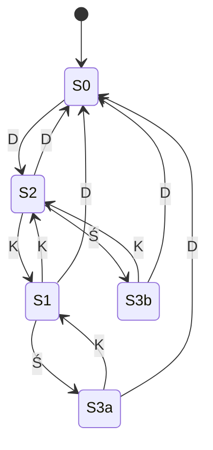

# Plan: układ sekwencyjny obsługi przycisku zasilania telefonu (LOGO! Soft Comfort, LAD)

Dokument zastępuje `lab5.md` i `dopracowanie.md`. Jest podstawą do napisania sprawozdania.

---

## 1. Problem

Jeden przycisk `I1` steruje dwoma wyjściami: `Q2` (telefon) i `Q1` (ekran). Rodzaj działania zależy od czasu przytrzymania przycisku i od aktualnego stanu urządzenia.

| Rodzaj kliknięcia | Czas przytrzymania | Kiedy rozpoznawane |
|---|---|---|
| Krótkie (K) | < 0,5 s | w chwili puszczenia przycisku |
| Średnie (Ś) | 0,5 s ≤ t < 2 s | w chwili puszczenia przycisku |
| Długie (D) | ≥ 2 s | po upływie 2 s, jeszcze podczas trzymania |

Przyjęte uproszczenie: po długim kliknięciu puszczenie przycisku nie generuje już żadnego zdarzenia.

### 1.1. Wymagania

- R1. Telefon wyłączony: K i Ś nie robią nic, D uruchamia telefon, a ekran włącza się.
- R2. Telefon włączony: K przełącza ekran (włączony/wygaszony).
- R3. Telefon włączony: Ś otwiera menu wyłączenia. Menu zawsze wymusza włączony ekran.
- R4. Menu otwarte: K anuluje menu i przywraca stan ekranu sprzed otwarcia.
- R5. Menu otwarte: Ś pozostawia menu otwarte.
- R6. D w dowolnym stanie włączonym wyłącza telefon, zamyka menu i gasi ekran.
- R7. Ekran nigdy nie świeci, gdy telefon jest wyłączony.
- R8. Jedno naciśnięcie generuje dokładnie jedno zdarzenie (K, Ś albo D). Trzymanie przycisku dłużej niż 2 s nie powoduje powtórnych przełączeń.

---

## 2. Automat stanów

### 2.1. Stany

Stan kodują trzy zmienne pamięci: `M1` (telefon), `M2` (zapamiętany stan ekranu), `M3` (menu otwarte). Stan S3 wymaga rozróżnienia, bo po anulowaniu trzeba wrócić do poprzedniego stanu ekranu.

| Stan | Nazwa | M1 | M2 | M3 | Q2 | Q1 |
|---|---|---|---|---|---|---|
| S0 | Telefon wyłączony | 0 | 0 | 0 | 0 | 0 |
| S1 | Praca, ekran zgaszony | 1 | 0 | 0 | 1 | 0 |
| S2 | Praca, ekran włączony | 1 | 1 | 0 | 1 | 1 |
| S3a | Menu otwarte (wejście z S1) | 1 | 0 | 1 | 1 | 1 |
| S3b | Menu otwarte (wejście z S2) | 1 | 1 | 1 | 1 | 1 |

Stany spoza tabeli są niedozwolone. Dotyczy to w szczególności `M1=0` przy `M2=1` albo `M3=1`. Pokazano niżej, że program ich nie generuje.

### 2.2. Tabela przejść

| Stan obecny | K | Ś | D |
|---|---|---|---|
| S0 | S0 | S0 | S2 |
| S1 | S2 | S3a | S0 |
| S2 | S1 | S3b | S0 |
| S3a | S1 | S3a | S0 |
| S3b | S2 | S3b | S0 |



Pominięte pętle: S0 z K i Ś, S3a i S3b ze Ś.

### 2.3. Wyjścia

```
Q2 = M1
Q1 = M1 · (M2 + M3)
```

Dzięki członowi `M1` spełnione jest R7 także w razie niespójności pamięci.

---

## 3. Zasada rozpoznawania kliknięć

### 3.1. Dlaczego nie wystarczy detekcja zbocza z timerami

Timery TON `T001` i `T002` zerują się w tym samym cyklu, w którym przycisk jest puszczany. Impuls zbocza opadającego i stan timerów nie są więc widoczne jednocześnie. Dlatego w programie przechowujemy wartości sygnałów z poprzedniego cyklu w markerach, a zdarzenia wyznaczamy jako jednocyklowe impulsy.

Zasada: marker zapisany na końcu programu (sieć 7) jest odczytywany w sieciach 2–6 jako wartość z poprzedniego cyklu.

### 3.2. Markery pamięci poprzedniego cyklu

| Symbol | Opis | Zapis (sieć 7) |
|---|---|---|
| M7 | I1 z poprzedniego cyklu | `I1 → M7` |
| M8 | T001 (próg 0,5 s) z poprzedniego cyklu | `T001 → M8` |
| M9 | T002 (próg 2 s) z poprzedniego cyklu | `T002 → M9` |

### 3.3. Zdarzenia (każde trwa dokładnie jeden cykl)

```
M4 (K) = M7 · /I1 · /M8
M5 (Ś) = M7 · /I1 · M8 · /M9
M6 (D) = T002 · /M9
```

Interpretacja:
- `M7 · /I1` – przycisk był wciśnięty i został puszczony (zbocze opadające).
- `/M8` – w poprzednim cyklu próg 0,5 s nie był przekroczony, czyli klik był krótki.
- `M8 · /M9` – próg 0,5 s przekroczony, a 2 s nie, czyli klik średni.
- `T002 · /M9` – zbocze narastające `T002`, czyli próg 2 s właśnie osiągnięty, czyli klik długi.
- Po długim kliknięciu przy puszczeniu `M8=1` i `M9=1`, więc `M4` i `M5` są 0 (zgodnie z R8).

### 3.4. Przykładowe przebiegi

Kliknięcie średnie (1 s):

| Moment | I1 | T001 | M7 | M8 | M5 |
|---|---|---|---|---|---|
| naciśnięcie, 1. cykl | 1 | 0 | 0 | 0 | 0 |
| 0,3 s | 1 | 0 | 1 | 0 | 0 |
| 0,6 s | 1 | 1 | 1 | 0→1 | 0 |
| puszczenie, 1. cykl | 0 | 0 | 1 | 1 | **1** |
| następny cykl | 0 | 0 | 0 | 0 | 0 |

Kliknięcie krótkie: przy puszczeniu `M7=1`, `M8=0`, więc `M4=1` przez jeden cykl.
Kliknięcie długie: `M6=1` przez jeden cykl, gdy `T002` właśnie zmienia się na 1 (`M9` jeszcze 0). Przy puszczeniu brak zdarzeń.

---

## 4. Równania sterowania (przerzutniki RS)

Zasada projektowa: warunki Set i Reset każdego przerzutnika wykluczają się wzajemnie. Poprawność nie zależy więc od priorytetu w bloku RS ani od kolejności ewaluacji wewnątrz bloku.

### 4.1. Telefon (`M1`)

```
S1: M6 · /M1       (D przy wyłączonym telefonie → włącz)
R1: M6 · M1        (D przy włączonym telefonie → wyłącz)
```

### 4.2. Ekran (`M2`)

```
S2: M4 · M1 · /M3 · /M2  +  M6 · /M1
R2: M4 · M1 · /M3 · M2   +  M6 · M1
```

- Pierwszy składnik Set/Reset to przełączanie ekranu krótkim klikiem, tylko przy włączonym telefonie i zamkniętym menu.
- Przy otwartym menu (`M3=1`) K nie zmienia `M2`. To daje powrót do stanu ekranu sprzed menu (R4).
- `M6 · /M1` zapala ekran przy uruchamianiu telefonu (S0→S2).
- `M6 · M1` zeruje ekran przy wyłączaniu telefonu.

### 4.3. Menu (`M3`)

```
S3: M5 · M1
R3: M4 · M3  +  M6
```

- Ś otwiera menu tylko przy włączonym telefonie.
- K zamyka menu (anulowanie), D zamyka menu przy wyłączaniu telefonu.
- Zdarzenia `M4`, `M5`, `M6` są parami rozłączne w czasie, więc Set i Reset nigdy nie są jednocześnie aktywne.

### 4.4. Kolejność sieci

Kolejność ma znaczenie. Sieć 3 (ekran) musi być przed siecią 4 (menu), a obie przed siecią 5 (telefon). W cyklu zdarzenia sieci 3 i 4 widzą wtedy jeszcze stare `M3` i `M1`.

### 4.5. Dowód braku stanów niedozwolonych

- `M1` zmienia się wyłącznie przez `M6`, a `M6` jednocześnie zeruje `M2` i `M3` (przy wyłączaniu) albo ustawia `M2` (przy włączaniu). Po wyłączeniu zawsze jest `M2=0`, `M3=0`.
- `M3` jest ustawiane tylko, gdy `M1=1`.
- Zatem `M1=0` implikuje `M2=0` i `M3=0`.
- Dodatkowo `Q1 = M1·(M2+M3)` blokuje ekran niezależnie od markerów.

---

## 5. Realizacja w LOGO! Soft Comfort (LAD)

### 5.1. Elementy

| Element | Typ | Parametry |
|---|---|---|
| I1 | wejście | przycisk chwilowy (w symulacji: przycisk, nie przełącznik) |
| Q1, Q2 | wyjścia | ekran, telefon |
| T001 | opóźnienie załączania (TON) | 0,50 s, Rem=off |
| T002 | opóźnienie załączania (TON) | 2,00 s, Rem=off |
| RS_M1, RS_M2, RS_M3 | przerzutnik RS | Rem=off |
| M1–M9 | markery | wg tabel w pkt 2.1, 3.2 i 3.3 |

Po wstawieniu timerów sprawdź w parametrach format czasu. Bloki muszą dawać 0,5 s i 2 s, a nie 50 s i 2 min.

### 5.2. Sieci

Każdy rząd to szeregowe styki zakończone cewką lub wejściem bloku. Zapis `A + B` oznacza dwie gałęzie połączone równolegle do tego samego wejścia.

**Sieć 1 – pomiar czasu**
- `I1 → T001 (Trg)`
- `I1 → T002 (Trg)`

**Sieć 2 – rozpoznawanie zdarzeń**
- `M7 · /I1 · /M8 → cewka M4`
- `M7 · /I1 · M8 · /M9 → cewka M5`
- `T002 · /M9 → cewka M6`

**Sieć 3 – ekran**
- Wejście S bloku `RS_M2`: `M4·M1·/M3·/M2` równolegle z `M6·/M1`.
- Wejście R bloku `RS_M2`: `M4·M1·/M3·M2` równolegle z `M6·M1`.
- `RS_M2 → cewka M2`.

**Sieć 4 – menu**
- Wejście S bloku `RS_M3`: `M5·M1`.
- Wejście R bloku `RS_M3`: `M4·M3` równolegle z `M6`.
- `RS_M3 → cewka M3`.

**Sieć 5 – telefon**
- Wejście S bloku `RS_M1`: `M6·/M1`.
- Wejście R bloku `RS_M1`: `M6·M1`.
- `RS_M1 → cewka M1`.

**Sieć 6 – wyjścia**
- `M1 → Q2`.
- `M1 · (M2 równolegle z M3) → Q1`.

**Sieć 7 – pamięć poprzedniego cyklu (zawsze ostatnia)**
- `I1 → cewka M7`
- `T001 → cewka M8`
- `T002 → cewka M9`

### 5.3. Nazewnictwo (opisy styków na schemacie)

`I1` = "PRZYCISK", `T001` = "PRÓG 0,5 s", `T002` = "PRÓG 2 s", `M1` = "STAN TELEFONU", `M2` = "EKRAN – PAMIĘĆ", `M3` = "MENU", `M4` = "ZDARZENIE K", `M5` = "ZDARZENIE Ś", `M6` = "ZDARZENIE D", `M7`–`M9` = "POPRZEDNI I1 / T001 / T002".

---

## 6. Założenia do sprawdzenia w programie

1. Sieci LAD są wykonywane od góry do dołu, a marker odczytany przed zapisem ma wartość z poprzedniego cyklu. Testy 1–5 z pkt 7 to potwierdzają.
2. Format czasu timerów daje 0,5 s i 2 s.
3. W symulacji `I1` jest przyciskiem (puszczenie myszy generuje zbocze opadające).
4. Jeśli ewaluacja okazałaby się inna, awaryjnie trzeba zmienić kolejność sieci.

---

## 7. Plan testów (symulacja)

Start: S0. Czasy w sekundach.

| # | Stan przed | Akcja | Oczekiwany stan po | Q2 | Q1 |
|---|---|---|---|---|---|
| 1 | S0 | K (0,2) | S0 | 0 | 0 |
| 2 | S0 | Ś (1) | S0 | 0 | 0 |
| 3 | S0 | D (3) | S2 (zmiana już po 2 s) | 1 | 1 |
| 4 | S2 | K | S1 | 1 | 0 |
| 5 | S1 | K | S2 | 1 | 1 |
| 6 | S2 | Ś | S3b | 1 | 1 |
| 7 | S3b | K | S2 | 1 | 1 |
| 8 | S2 | K | S1 | 1 | 0 |
| 9 | S1 | Ś | S3a (ekran włączony przez menu) | 1 | 1 |
| 10 | S3a | K | S1 (ekran znów zgaszony) | 1 | 0 |
| 11 | S1 | Ś | S3a | 1 | 1 |
| 12 | S3a | Ś | S3a | 1 | 1 |
| 13 | S3a | D | S0, menu zamknięte | 0 | 0 |
| 14 | S0 | D | S2, menu zamknięte | 1 | 1 |
| 15 | S2 | Ś | S3b | 1 | 1 |
| 16 | S3b | D | S0 | 0 | 0 |
| 17 | S2 | D | S0 | 0 | 0 |
| 18 | S1 | D | S0 | 0 | 0 |

Testy brzegowe:
- Trzymanie przycisku 10 s w S2 powoduje jedno wyłączenie telefonu. Brak migotania `Q2` (R8).
- Trzymanie przycisku 10 s w S0 powoduje jedno włączenie. Brak migotania.
- Puszczenie tuż przed 0,5 s daje K, tuż po 0,5 s daje Ś.
- Puszczenie tuż przed 2 s daje Ś. Przekroczenie 2 s daje D, które zadziałało już w trakcie trzymania.
- Dwa szybkie krótkie kliknięcia z rzędu to dwa przełączenia ekranu.
- Po sekwencji z testów 13 i 14 menu jest zamknięte, co potwierdza obecność `M6` w `R3`.

Kryteria akceptacji: wszystkie testy 1–18 i testy brzegowe zgodne z tabelą, `Q1=1` przy `Q2=0` nigdy się nie pojawia.

---

## 8. Plan dokumentacji (sprawozdanie)

1. Opis problemu i wymagania (R1–R8, pkt 1).
2. Zmienne wejściowe, wyjściowe i pamięć (tabela `I1, Q1, Q2, M1–M9`).
3. Automat stanów: tabela stanów, tabela przejść i diagram (pkt 2).
4. Rozpoznawanie kliknięć: uzasadnienie dlaczego impulsy jednocyklowe, równania zdarzeń i przykładowe przebiegi czasowe (pkt 3).
5. Równania sterowania `M1`, `M2`, `M3` i wyjść; dowód braku stanów niedozwolonych (pkt 4).
6. Schemat bramkowy, jeśli wymagany przez prowadzącego. Wykorzystujemy te same równania.
7. Schemat LAD (zrzuty ekranu sieci 1–7).
8. Wyniki symulacji: tabela testów (pkt 7) z zaznaczeniem zaliczonych oraz zrzuty wybranych sytuacji.
9. Wnioski: zaleta przerzutników z wykluczającymi się warunkami, rola markerów poprzedniego cyklu, ograniczenia (stałe progi czasowe, jedno wejście).
10. Załączniki: plik projektu LOGO (`.lsc`), zrzuty ekranu.
